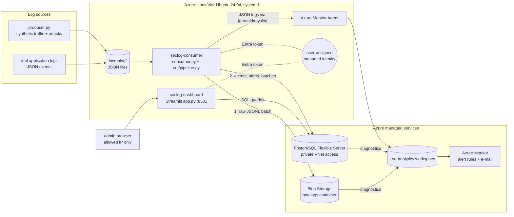
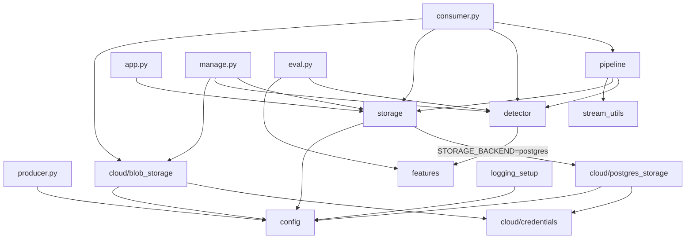
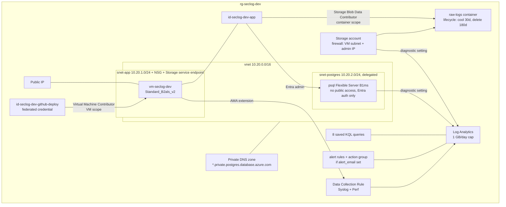
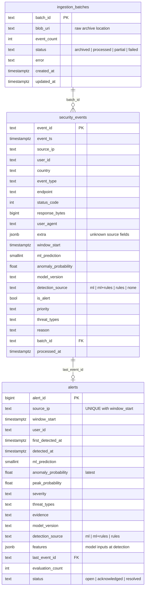

# Architecture

## 1. System architecture



**Cloud-managed services:** Blob Storage, Azure Database for PostgreSQL, Log
Analytics / Azure Monitor, managed identities, VNet/NSG and private DNS.
**Application code hosted on the VM:** consumer, dashboard, model and feature
code, and the optional producer, each a separate systemd service so it can be
restarted independently.

## 2. End-to-end data flow

```mermaid
sequenceDiagram
    autonumber
    participant SRC as Producer / log source
    participant IN as incoming/
    participant C as Consumer (pipeline)
    participant B as Blob Storage
    participant DB as PostgreSQL
    participant RF as Random Forest + rules
    participant UI as Dashboard

    SRC->>IN: write event file (atomic rename)
    C->>IN: read up to BATCH_SIZE files, validate
    Note over C: invalid -> quarantine/ (kept, not deleted)
    C->>B: upload raw batch raw/YYYY/MM/DD/HH/<batch>.jsonl (no overwrite)
    C->>DB: ingestion_batches(batch_id, blob_uri, 'archived')
    C->>DB: which event_ids already exist? (idempotency)
    loop each new event, in timestamp order
        C->>DB: (first time per user) successful-login history
        C->>RF: 5-minute IP window -> 18 features -> predict_proba
        RF-->>C: score, prediction, rule evidence, detection_source
        C->>DB: one transaction: INSERT event; UPSERT alert (ip, window)
        C->>IN: delete the file only after the commit
    end
    C->>DB: ingestion_batches status 'processed'
    UI->>DB: stats, recent alerts and events
```

Failure handling:

| Failure | Behaviour |
|---|---|
| Blob upload fails | Nothing is processed or deleted; the batch is retried with exponential backoff. |
| PostgreSQL unavailable | Processing stops at the failed event; that file and all later ones stay in `incoming/`. The batch is marked `partial`, then retried. In-memory window state is updated only after a commit, so retries are not double-counted. |
| Duplicate event (retry, re-delivery) | `event_id` primary key plus a pre-check; skipped, and its alert is not re-counted. |
| Malformed event | Moved to `quarantine/` with an `.error.txt`; the raw copy is still archived if it was valid JSON. |
| Consumer restart or VM reboot | systemd restarts it. Windows for the last 6 minutes are rebuilt from PostgreSQL, and login history is reloaded lazily per user. |
| Out-of-order events | Each event is scored on events in `[ts - 5 min, ts]` only. Late events up to `ALLOWED_LATENESS_SECONDS` (60 s) are kept in memory. |
| Model missing or invalid in Azure | The consumer refuses to start (`REQUIRE_MODEL=true`); it never silently runs rules-only. |
| Cloud mode misconfigured | `validate_settings()` stops startup; there is no silent fallback to CSV. |

A retried batch may be archived twice in Blob Storage (different batch IDs,
same events). The archive is append-only; PostgreSQL de-duplicates by `event_id`.

## 3. Module dependency map



`storage.StorageBackend` is the single interface used by the consumer, the
dashboard and `manage.py`. `CsvStorage` is local development; `PostgresStorage`
is Azure. Archival has the same split: `LocalArchiver` and `BlobArchiver`.

## 4. Azure resources (Terraform)



Network exposure: the NSG allows SSH (22) and the dashboard (8501) **only from
`admin_ip_cidr`** (plus optional `dashboard_allowed_cidrs`). PostgreSQL has no
public endpoint, and the storage account firewall admits only the VM subnet
and the admin IP.

## 5. Database schema



Indexes cover event time, `(source_ip, event_ts)`, `processed_at`, alert time,
severity and detection source. A **partial index** on successful logins,
`(user_id, event_ts) WHERE event_type='login' AND status_code BETWEEN 200 AND 399`,
serves the login-history lookup, so no separate `login_history` table is
needed and the whole history is never loaded into memory. Migrations live in
`src/cloud/migrations/` and are applied by `python manage.py init-db` (versioned
in `schema_migrations`, serialized with an advisory lock).

## 6. Detection design

* **Inputs.** The 18 features are listed in `src/features.py:FEATURE_COLUMNS`.
  The bundle's `feature_columns` and the model's `feature_names_in_` must match
  them exactly, or loading fails. Missing, NaN or non-numeric values become 0.
* **Anomaly class.** It is looked up by label (`ANOMALY_LABEL=1`) in
  `model.classes_`, never assumed to be index 1. The prediction is the class
  with the highest score, which is what `RandomForestClassifier.predict` does.
* **Severity.** Rule severities (LOW to CRITICAL) as before. A window the model
  flags is at least MEDIUM, and the model score never raises severity above MEDIUM.
* **Alert key.** There is one alert per `(source_ip, five-minute bucket)`. Later
  events in the same bucket update it (latest state, `peak_probability`,
  `evaluation_count`).
* **Notifications.** When a window first reaches HIGH or CRITICAL, the consumer
  logs a `threat_alert` record. An Azure Monitor log alert e-mails the
  administrator (Alert and Notification module).
* **The score is not a calibrated probability.** It is the fraction of trees voting anomalous.
